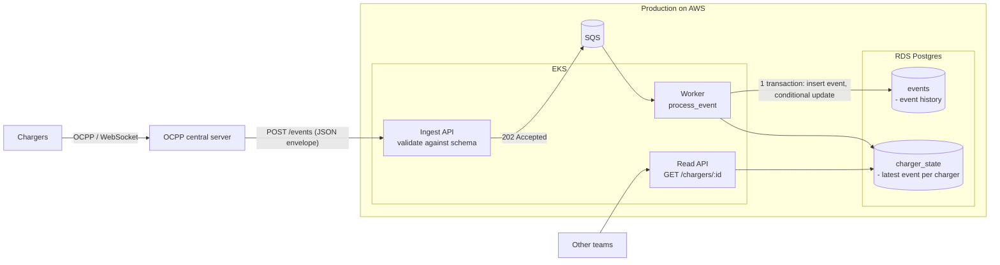

# Charger Telemetry Ingest - Spirii Take-Home

1. [Architecture](#1-architecture)
2. [Platform and Developer Experience](#2-platform-and-developer-experience)
3. [Runnable Slice](#3-runnable-slice)
4. [Operations](#4-operations)
5. [Trade-offs](#5-trade-offs)

---

## 1. Architecture

### Diagram



### Ingest

Chargers talk to an existing central server via OCPP, which normalises messages into JSON events and POSTs them to the ingest API. The API validates each event against its schema, enqueues it to SQS and returns `202 Accepted`. Invalid events get `422` and never enter the pipeline. In the runnable slice, the API calls the processing function directly instead of going through SQS.

### Processing

A worker handles each event in one database transaction: insert into `events` table (event history); if it's already there, it's a duplicate and processing stops. Otherwise, the event type's handler updates its field in `charger_state`, but only if this event is newer than the one that last set it.

### History

History lives in the append-only `events` table in Postgres (RDS in production): one row per accepted event, never updated. Payloads are stored as JSON, so a new event type needs no table change. History is the source of truth; the snapshot can be rebuilt or backfilled by replaying it.

### Latest state

Latest state lives in `charger_state` in the same database: one row per charger, overwritten as newer information arrives. Each field also stores when it was set and by which event, which is how late and duplicate events are ignored. Reads hit one row, so they stay fast as history grows.

### Data Model

The json snippet below shows the envelope used by every event, and it has a type specific payload:

```json
{
  "eventType": "StatusNotification",
  "chargePointId": "CP_10",
  "connectorId": 1,
  "messageId": "30",
  "timestamp": "2026-10-10T10:03:00Z",
  "payload": { "status": "Charging" }
}
```

| Event type | Payload |
|---|---|
| `StatusNotification` | Status: `Available`, `Charging`, `Faulted` |
| `MeterValues` | Power: int >= 0 |

**`events` table:** Where we store event history

| `charge_point_id` | `message_id` | `event_ts` | `event_type` | `connector_id` | `payload` (jsonb) | `received_at` |
|---|---|---|---|---|---|---|

Primary key: `(charge_point_id, message_id, event_ts)`

**`charger_state` table:** Where we store the latest state- one row per charger.

| `charge_point_id` | `status` | `status_at` | `status_msg_id` | `power_w` | `power_at` | `power_msg_id` |
|---|---|---|---|---|---|---|

### Correctness

**Duplicates.** Every event is inserted into `events` table with `ON CONFLICT DO NOTHING` on the primary key. If nothing was inserted, it's a duplicate. `charge_point_id` is in the key because `messageId` is only unique per charger; `event_ts` because chargers can reuse IDs after a reboot.

**Out of order.** A field in the `charger_state` table only updates if the new event's `(timestamp, messageId)` is greater than the stored one. Ordering uses the charger's event time. Ties go to the higher `messageId`. Out of order events are accepted in the `events` table.

---

## 2. Platform and Developer Experience

### A second team needs to add a new telemetry event type, or read latest-state for the first time. They shouldn't have to wait on the Cloud team to do it. Walk us through how they'd do it themselves, what's self-serve, what still needs a review, and why.

**Adding a new telemetry event type:**

First, the team would define a new event type and follow the pattern for how the existing event types are defined/ implemented. Then they don't need to update the `events` table, as the payload of the new event type should be in json, and this already fits into the generically-typed jsonb `payload` column. All this is self-serve.

However, the `charger_state` table in the DB will need new columns added to support the new event type's payload- due to this, a review will be needed from the DB owner, and this part is not self-serve.

**Reading latest-state for the first time:**

Check the docs for how to use the read API. This part is self-serve, and does not need any review because they are just using the read part of the API.

### Where's the line between what the platform owns and what product teams own, and how do you actually hold that line?

Product teams own modules inside the application code, and the platform owns the ingest and read API, and the infrastructure. However, there is an interface between the teams at the DB, when schema migrations need to happen, i.e. new event types are added. We could hold the line using codeowners with branch protection.

### As more teams come to depend on this over time, how do you keep them safe by default, without the Cloud team reviewing every change by hand?

We could enable developers to deploy their own limited test environments, so that they can have self service when developing and testing new event types. We could also add an orchestration pipeline like Github Actions to automatically apply changes to and run tests against a shared development environment. PRs from dev teams would only get merged on green runs.

### How would you get teams to actually use it, and how would you know whether it's any good to build on?

Clear communication through a public channel. Show examples to make adoption easier.
We could also have a separate channel to accept developer feedback and criticism.

---

## 3. Runnable Slice

<details>
<summary><strong>Show how to run locally and curl examples</strong></summary>

## Running locally

Needs Docker with Compose. Nothing else is installed on the host.

```bash
docker compose up --build -d
```

Check it is up (the first build takes a minute):

```bash
curl -s localhost:8000/healthz
# {"status":"ok"}
```

The API is on http://localhost:8000 (interactive docs at http://localhost:8000/docs).
Postgres is not published to the host.

### Tests

```bash
docker compose run --rm app pytest
```

The tests run against the same Postgres as the app and truncate both tables first, so
they wipe anything you have posted by hand.

### Try it

Write a status:

```bash
curl -s -X POST localhost:8000/events -H 'Content-Type: application/json' -d '{
  "eventType": "StatusNotification", "chargePointId": "CP-1", "messageId": "m-1",
  "timestamp": "2026-10-10T10:05:00Z", "payload": {"status": "Charging"}}'
# {"result":"stored"}
```

Send the same event again (duplicate):

```bash
curl -s -X POST localhost:8000/events -H 'Content-Type: application/json' -d '{
  "eventType": "StatusNotification", "chargePointId": "CP-1", "messageId": "m-1",
  "timestamp": "2026-10-10T10:05:00Z", "payload": {"status": "Charging"}}'
# {"result":"duplicate"}
```

Send an older event (out of order). It goes into history but does not change the latest
state:

```bash
curl -s -X POST localhost:8000/events -H 'Content-Type: application/json' -d '{
  "eventType": "StatusNotification", "chargePointId": "CP-1", "messageId": "m-2",
  "timestamp": "2026-10-10T10:03:00Z", "payload": {"status": "Available"}}'
# {"result":"stored"}
```

Write a meter value:

```bash
curl -s -X POST localhost:8000/events -H 'Content-Type: application/json' -d '{
  "eventType": "MeterValues", "chargePointId": "CP-1", "messageId": "m-3",
  "timestamp": "2026-10-10T10:04:00Z", "connectorId": 1, "payload": {"powerW": 7200}}'
# {"result":"stored"}
```

Read latest state:

```bash
curl -s localhost:8000/chargers/CP-1
# {"chargePointId":"CP-1","status":"Charging","statusAt":"2026-10-10T10:05:00Z",
#  "powerW":7200.0,"powerAt":"2026-10-10T10:04:00Z"}
```

Read history (newest first, three events, `?limit=` defaults to 50):

```bash
curl -s localhost:8000/chargers/CP-1/events
```

List all chargers (ordered by id; page with `?limit=` and `?after=<last id>`):

```bash
curl -s localhost:8000/chargers
```

### Inspect

To look at the tables directly (put any SQL after `-c`):

```bash
docker compose exec db psql -U postgres telemetry -c '\dt'
```

To see the latest 20 lines of app logs:

```bash
docker compose logs --tail 20 app
```

### Reset

```bash
docker compose down -v
```

This deletes the database volume. `db/schema.sql` only runs on an empty volume, so this is
also needed after changing the schema.

</details>

---

## 4. Operations

### How would you deploy it?

GitHub Actions runs tests against Postgres, builds an image tagged with the git SHA, and pushes it to ECR. It then deploys to staging and, after checks pass, to production on EKS.

### How would you manage the infrastructure?

It is all defined in IaC, version controlled in Github, and changes to it have to be tested and get merged through PRs. Set up logging and metrics in AWS Cloudwatch, and write some AWS alarms in IaC and deploy them- we want to minimize manual changes to Cloudwatch alarms. Then we connect the alarms to (for example) PagerDuty or Datadog to send alerts to on-call members when alarm thresholds have been breached.

### How would you handle secrets?

Secrets like the prod DB password would be stored in AWS Secrets Manager. Secrets could only be retrieved by infra resources via IAM roles scoped exactly to the secret they need. Only privileged members of the Cloud team would have access to read all secrets.

### How would you roll back when something breaks?

We would keep a certain number of known previous stable images, tagged with "stable", so we could quickly redeploy one of these.

### What would you alert on?

I would alert on metrics like API error rate (5xx, 4xx) and latency. I would also consider adding alerts on CPU usage, DB load, request queue size.

### What does a safe deploy look like?

We do tests in the staging environment first, then a gradual rollout or canary deploy. We scale up the percentage of API traffic in stages. All the while, we are continuously observing the above-mentioned metrics.

---

## 5. Trade-offs

### What did you assume?

For my runnable slice, I assumed low traffic, and that the events coming to the telemetry ingest platform are being sent to it from an upstream OCPP central server, with the events having been normalized to fit the request envelope.

### What did you leave out on purpose?

I purposely left out the SQS request queue because I felt it wasn't needed to prove correctness of the runnable slice. Correspondingly, I left out the request worker on the service level.

I also purposely made authentication, IaC, CI/CD, and a DB schema migration framework out of scope.

### What breaks first when traffic grows 10x?

If event posting traffic grows 10x then DB concurrency limits might be reached.

The events table also grows without bounds, so we might need to partition that table.

### What would you build next?

I would add the SQS queue to smooth out spikes in ingest traffic, and a request handling worker to process the requests in the queue.
